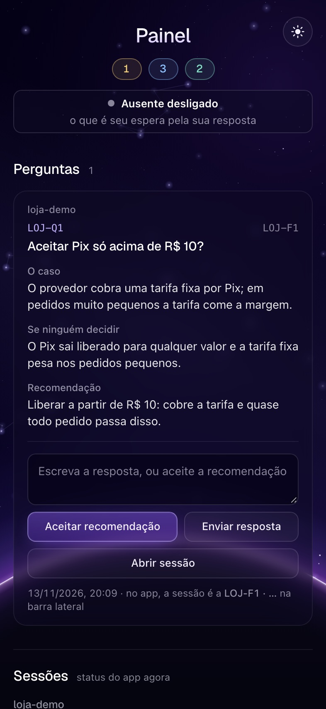
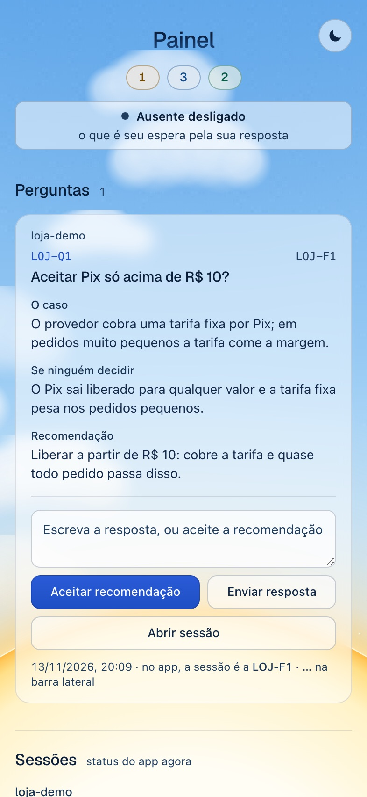
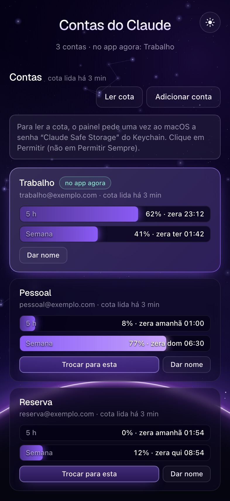
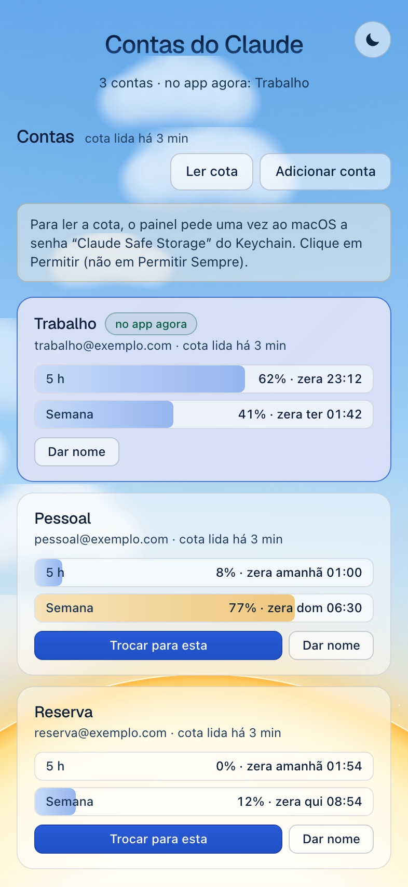

# ichikawa-plugins

**Um time de sessões do Claude Code trabalhando por você, com processo de gente grande e um painel para você só decidir.**

Você faz o pedido uma vez. A **orquestradora** quebra o pedido em itens e abre uma **sessão dona** para cada um. Cada dona planeja, executa em ondas com até 4 executoras ao mesmo tempo, confere com a saída real dos testes, abre o PR e mergeia. Revisor só entra no que tem risco. O que precisa de você vira uma pergunta completa num **painel local**: o caso, o que acontece se você não decidir e a recomendação. Você responde com um clique. No fim, o release leva a `develop` para a `main`.

Junto vêm os padrões da stack (React, TypeScript, Next, Postgres, Google Cloud), uma barra acima do prompt com o relógio do cache e os botões do kit, e um painel para trocar de conta do app sem Sign out.

<p align="center">
  
  
</p>
<p align="center"><sub>As sessões de cada projeto no Painel: quem está planejando, executando, em revisão ou com PR aberto, quem espera você e quem está parado. O Painel (<code>http://127.0.0.1:4747</code>) nos dois céus, noite e dia; o botão no canto troca o tema, e a escolha vale para a barra e para o painel de contas. Dados de exemplo.</sub></p>

---

## Sumário

- [Como o kit trabalha](#como-o-kit-trabalha)
- [Os plugins](#os-plugins)
- [`orquestracao`: a orquestradora, as donas e o Painel](#orquestracao)
- [`stack`: os padrões e os revisores da stack](#stack)
- [`barra`: a barra acima do prompt](#barra)
- [`design-wicomm`: o design system interno da Wicomm](#design-wicomm)
- [`contas`: várias contas do app sem Sign out](#contas)
- [Instalar e atualizar](#instalar-e-atualizar)
- [Plugins de fora recomendados](#plugins-de-fora-recomendados)
- [Desenvolver o kit](#desenvolver-o-kit)

---

## Como o kit trabalha

```
 você ──pedido──▶ ORQUESTRADORA ──abre uma sessão por item──▶ DONA IZA-F7   DONA IZA-F8   …
                     ▲     │                                     │
                     │     └── repassa o que é do operador       ├─ planeja    docs/planos/AAAA-MM-DD-slug.md
                     │                                           ├─ executa    em ondas, até 4 executoras juntas
     PAINEL ◀── pergunta (caso · se não decidir · recomendação)  ├─ confere    testes afetados + typecheck, saída real
  127.0.0.1:4747                                                 ├─ revisa     revisor só nos itens de risco
     │                                                           ├─ PR para develop, merge por squash
     └── você responde com um clique; a resposta chega à dona    └─ grava a entrega e se arquiva
                                                                          │
                                         develop ──release (gate completo, seu ok)──▶ main
```

1. **Você pede.** A sessão com o papel de orquestradora (`orquestracao:orquestradora`) entende o pedido. Quando há decisão de produto, desenha com você antes (`orquestracao:brainstorming`). Depois quebra o pedido em itens independentes: um item é uma entrega que faz sentido sozinha num PR.
2. **Uma dona por item.** Para cada item, a orquestradora registra o item (`perguntas item nova` imprime `IZA-F7`), põe a pasta principal na `origin/develop` e abre uma sessão nova, num worktree próprio, com um brief curto. A orquestradora não escreve código de produto: um hook pergunta antes de ela editar.
3. **A dona planeja** (`orquestracao:planejar`): arquivos, interfaces e tarefas pequenas com teste primeiro, cada uma marcada `Risco: sim/não`, e as **ondas**, ou seja, as tarefas que podem rodar juntas.
4. **Executa em ondas** (`orquestracao:executar-plano`). Cada onda sai de uma vez: até 4 executoras (`orquestracao:executor`, em Sonnet), uma por tarefa, na mesma pasta. Duas tarefas da mesma onda nunca dividem arquivo. A dona (em Opus) confere a onda inteira, roda os testes afetados e o typecheck e commita tarefa por tarefa.
5. **Confere e revisa.** Nada é "pronto" sem a saída do comando (`orquestracao:verificar-antes-de-concluir`). O revisor (`orquestracao:revisor`, Opus, em contexto separado) só entra nos itens de risco: autenticação, permissão ou segredo; dinheiro; migração ou dado que não volta; diff com mais de ~400 linhas. O resto passa pela autorrevisão da skill `orquestracao:revisar`.
6. **PR e merge.** A dona abre o PR para a `develop` (`orquestracao:entregar-branch`) e mergeia por squash quando o CI passa. Não há fila: cada dona cuida do próprio PR. Depois ela grava a entrega (resultado, o que mediu, o que não mediu, próximos passos) e se arquiva.
7. **Perguntas vão ao Painel.** O que é seu (irreversível, destrutivo, produção, gasto, o que publica para fora) vira `perguntas nova`, com o caso, o que acontece se ninguém decidir e a recomendação. Decisão de baixo risco a sessão assume, marca *assumida, a confirmar* e segue. Dois hooks garantem que nenhuma pergunta fique só no chat.
8. **Release.** A orquestradora sugere a hora. Com o seu sim, `orquestracao:release` roda o gate completo e leva a `develop` à `main` por avanço rápido. O push na `main` dispara o deploy.

---

## Os plugins

Os plugins não importam código uns dos outros. Eles se encontram só por arquivos em `~/.claude/ichikawa/` e por comandos, descritos em [`docs/contratos.md`](docs/contratos.md). Cada um funciona sozinho; juntos, a barra ganha os botões do Painel e de Contas.

| Plugin | Em uma frase | Onde ligar |
|---|---|---|
| [`orquestracao`](#orquestracao) | Orquestradora, donas, Painel de perguntas e entregas, e o processo: planejar, TDD, depurar, revisar, release | conta (todo projeto) |
| [`stack`](#stack) | Skills de consulta e agentes revisores de React/TS, Next, Vite, Tailwind, API, Postgres, deploy, Google Cloud, segurança, desempenho e SEO, com o Context7 | conta |
| [`barra`](#barra) | A barra acima do prompt: cache de 1 h, tema, modo ausente e os botões dos outros plugins | conta |
| [`design-wicomm`](#design-wicomm) | Design system dos apps React **internos da Wicomm**: base, tema, designer, crítico e auditoria | só no projeto interno |
| [`contas`](#contas) | Painel local com a cota de cada conta do app do Claude e a troca de conta sem Sign out (macOS) | conta |

---

<a id="orquestracao"></a>
## `orquestracao`: a orquestradora, as donas e o Painel

**O que faz.** Transforma uma sessão em orquestradora e cada item em uma sessão dona, guarda as perguntas e as entregas fora das conversas (no `perguntas`) e traz o processo inteiro de engenharia em skills curtas, em PT-BR.

### Como usar

- **Orquestrar:** numa sessão na pasta do projeto, diga *"você é a orquestradora"* ou *"orquestra isso"*. Ela marca o papel (`perguntas papel orquestradora`), dá o título `🎛 orquestradora — <projeto>` e mostra o que está vivo.
- **Trabalho de uma sessão só:** sem orquestradora, as skills funcionam do mesmo jeito. Peça *"planeja"*, *"executa o plano"*, *"abre o PR"*, *"faz o release"*.
- **O Painel:** o botão **◫ Painel** da barra abre `http://127.0.0.1:4747` no navegador do app, com um selo de quantas perguntas estão abertas. Sem a barra: `perguntas pagina --abrir`.

### O Painel

| Seção | O que mostra |
|---|---|
| **Perguntas** | As abertas de todos os projetos: o caso, o que acontece se ninguém decidir e a recomendação. Botões **Aceitar recomendação**, **Enviar resposta** e **Abrir sessão**. A resposta chega à sessão que perguntou, pela barra. |
| **Sessões** | Um grupo por projeto, com a etapa de cada item (planejamento → execução → revisão → PR → entregue), quem espera você, quem está rodando agora e o link para abrir no app. |
| **Entregues** | As entregas dos últimos 30 dias: resultado, o que foi medido, o que ficou sem medir, próximos passos e o PR. |

O aviso de modo ausente fica no topo. Itens entregues há mais de 30 dias vão para `arquivo/` e nada é apagado.

### O CLI `perguntas`

Entra no PATH das sessões com o plugin ligado. Os ids levam a sigla do projeto (`IZA-F7`, `IZA-Q12`); o CLI aceita com ou sem a sigla.

```bash
perguntas nova --titulo T --caso C --se-nao S --recomendacao R --item IZA-F7   # imprime IZA-Q12
perguntas responder IZA-Q12 "resposta dada no chat"
perguntas listar | perguntas novidades | perguntas contar
perguntas item nova "título" | item etapa F7 execucao | item ver F7 | item listar
perguntas item entregar F7 --desfecho entregue --resultado "…" --medido "…" --nao-medido "…" --proximo "…" --pr 12
perguntas papel orquestradora --sessao-id ID | passar-papel --sessao-id ID
perguntas sigla [SIG] | arquivar | pagina [--abrir | --subir] [--porta 4747]
```

### Skills

| Skill | Para quê |
|---|---|
| `orquestradora` | O papel: quebrar o pedido em itens, abrir as donas, responder a elas, levar a você só o que é seu e sugerir o release. Limpa o próprio contexto sozinha quando passa de ~150 mil tokens. |
| `dona` | O papel de dona de um item: planejar, executar, conferir, PR, merge por squash, gravar a entrega e se arquivar. |
| `brainstorming` | Desenhar antes de planejar: duas ou três abordagens com a recomendada, e o desenho aprovado no topo do plano. |
| `entrevistar` | Uma entrevista rodada a rodada até o plano ficar sem ponto cego (*"me entrevista"*, *"grill me"*). |
| `planejar` | O plano em `docs/planos/AAAA-MM-DD-slug.md`: tarefas com teste primeiro, risco por tarefa e ondas de até 4. |
| `executar-plano` | Executa em ondas, com uma executora por tarefa, conferência por onda e andamento registrado no próprio plano. |
| `paralelizar-agentes` | Vários subagentes de uma vez para problemas que não se ligam. |
| `tdd` | Teste que falha pelo motivo certo, o mínimo para passar, refatorar no verde. |
| `testes-de-tela` | Onde mora cada teste de React: componente (Testing Library) ou ponta a ponta (Playwright). |
| `depurar` | A causa raiz antes do conserto, em quatro fases. |
| `auditoria-de-clique` | Segue cada clique até o estado final, para achar o botão que "não faz nada". |
| `verificar-antes-de-concluir` | Nenhum "pronto" sem a saída do comando que prova. |
| `revisar` / `receber-revisao` | Decide se precisa de revisor e conduz a revisão; recebe achados com rigor, sem concordância encenada. |
| `revisar-chamado` | Triagem de issue do GitHub conferida contra o código. Nada é publicado sem pedido. |
| `entregar-branch` | Testes afetados, atualizar com `origin/develop`, push, PR e merge por squash. |
| `release` | Gate completo na máquina e avanço rápido da `develop` para a `main`, só com o seu ok. |
| `migrations-seguras` | Migration de Postgres/Supabase que não trava a tabela nem fica pela metade. |
| `adr` / `spec` | Decisão de arquitetura em `docs/adr/`; specs só em projeto que já trabalha com elas. |
| `conhecer-projeto` | Reconhecer um repositório novo e propor o `CLAUDE.md`. |

### Agentes

| Agente | Modelo | Papel |
|---|---|---|
| `executor` | Sonnet | Cumpre uma tarefa de um plano fechado: código e testes, só os testes afetados, relatório com a saída real. Não commita. |
| `explorador` | Haiku | Busca e leitura rápidas: onde está X, quem chama Y. |
| `revisor` | Opus | Revisa mudança de risco contra o plano e devolve Crítico/Importante/Menor com arquivo:linha. Não edita. |
| `conserta-build` | Sonnet | Conserta build, typecheck ou lint quebrado com o menor diff, sem afrouxar regra. |

### Hooks

A maioria avisa ou pergunta antes. Só três seguram: a mensagem com segredo para outra sessão, a caixa que espera você sem a pergunta gravada e o fim de turno com bloco de decisão sem registro (devolvido uma vez).

| Quando | Hook | O que faz |
|---|---|---|
| Início da sessão | `inicio` | Injeta as regras do kit, o papel herdado, o modo ausente e as respostas do Painel ainda não lidas. |
| Antes de editar | `orquestradora-nao-edita` | A orquestradora não escreve código de produto: pergunta antes. |
| Antes de editar | `config-protegida` | Mexer em configuração de lint, formatador ou tipos pergunta antes (o certo é consertar o código). |
| Antes de editar ou rodar Bash | `segredo-em-arquivo` | Pergunta antes de gravar segredo de verdade em arquivo e antes de `git add .env`. Nomeia o padrão, nunca o valor. |
| Antes de rodar Bash | `sem-no-verify` | `--no-verify` e afins perguntam antes. |
| Antes de mandar mensagem a outra sessão | `segredo-sai` | Recusa a mensagem que leva segredo a outra sessão. |
| Antes da caixa de próximo passo | `pergunta-na-caixa` | A caixa que espera você só passa com a pergunta gravada no Painel. |
| Depois de editar | `aviso-console-log`, `formatar-editado` | Avisa `console.log` em código de produto; formata só o arquivo editado, se o projeto declara Biome ou Prettier (`ICHIKAWA_FORMATAR=0` desliga). |
| Fim do turno | `pergunta-no-painel`, `orquestradora-limpa` | Cobra bloco de decisão (`**D…`, `**IZA-Q…`) sem registro; avisa quando o contexto da orquestradora pede limpeza. |

### Quando usar e quando não usar

- ✅ Vários pedidos em paralelo no mesmo projeto, trabalho que atravessa dias, ou quando você quer só decidir e deixar o resto andar.
- ✅ Sem orquestradora também: as skills de processo (planejar, TDD, depurar, revisar, release) valem em qualquer sessão.
- ⛔ Um ajuste de uma linha não precisa de dona: peça direto na sessão.
- ⛔ Itens que mexem nos mesmos arquivos não rodam em paralelo; a orquestradora os põe em sequência.
- ⛔ O "ok" de uma sessão nunca vale como o seu: push na `main`, gasto e o que publica para fora sempre voltam a você.

---

<a id="stack"></a>
## `stack`: os padrões e os revisores da stack

**O que faz.** Material de consulta da stack da empresa (React/TypeScript, Next.js, Node, Supabase/Postgres e Google Cloud) em skills curtas, mais agentes que revisam o diff em contexto separado e o MCP **Context7** para ler a documentação atual em vez da memória. Sem gate e sem cobertura mínima.

### Skills

| Skill | Para quê |
|---|---|
| `stack:react` | React 19: hooks, estado, efeitos, formulários com actions, fronteira server/client, Suspense |
| `stack:typescript` | TS estrito: `unknown`, união discriminada, schema na borda, erros tipados, async |
| `stack:nextjs` | Next 15/16 com App Router: cache, Server Actions, `proxy.ts`, hidratação, metadata |
| `stack:vite` | `vite.config`, variáveis de ambiente, proxy, chunks, deploy de SPA |
| `stack:tailwind` | Tailwind v4 com tokens e shadcn/ui, modo escuro, CVA, migração da v3 |
| `stack:animacao` | `motion/react` e CSS: molas, `prefers-reduced-motion`, AnimatePresence, SSR sem flash |
| `stack:api` | Rotas Next/Node: status, Zod, envelope de erro, paginação, N+1, transação, retry |
| `stack:postgres` | Índices, RLS rápida e segura, tipos, UPSERT, paginação por cursor, consulta lenta |
| `stack:deploy` | GitHub Actions, Dockerfile multi-stage, compose com Postgres, Cloud Run, rollback |
| `stack:google-cloud` | Service account, ADC/WIF sem chave JSON, Secret Manager, Scheduler, Pub/Sub, custo |
| `stack:seguranca` | Checklist ao escrever: segredos, entrada, XSS/CSRF, sessão, RLS, pagamento, OWASP 2025 |
| `stack:desempenho` | Medir antes de otimizar: Web Vitals, p95, bundle; métrica ruim → causa provável |
| `stack:seo-tecnico` | Indexação, canonical, sitemap, JSON-LD de produto (Next, FastStore, Wake) |
| `stack:codigo-morto` | Achar e apagar o que não é usado (knip, depcheck), em passos com teste |
| `stack:docs-atuais` | Consultar a doc atual pelo Context7, com fallback para a web |

### Agentes

| Agente | Modelo | Chame quando |
|---|---|---|
| `stack:revisor-react-ts` | Sonnet | Mudou componente, hook ou módulo TS |
| `stack:revisor-banco` | Opus | Migration, política de RLS, função SQL ou consulta nova |
| `stack:seguranca` | Opus | Tocou em auth, upload, pagamento, webhook, ou antes de release sensível |
| `stack:desempenho` | Sonnet | Algo está lento ou o Lighthouse reclamou |
| `stack:seo` | Sonnet | Auditar a vitrine (PLP/PDP), metatags e JSON-LD |
| `stack:docs` | Haiku | "Como se usa X na versão atual?" |

Os revisores só leem e devolvem achados Crítico/Importante/Menor; nenhum edita.

### Quando usar e quando não usar

- ✅ Ao escrever ou revisar código nessas tecnologias, e sempre que a resposta depende da versão atual de uma biblioteca.
- ⛔ Não é gate de CI nem linter: é consulta. Migration é da `orquestracao:migrations-seguras`; Supabase específico, do plugin `supabase@claude-plugins-official`.
- Precisa de Node ≥ 20.18.1 e internet para o Context7. A chave de API do Context7 é opcional e nunca vai no `.mcp.json`.

Detalhes e fontes: [`plugins/stack/README.md`](plugins/stack/README.md).

---

<a id="barra"></a>
## `barra`: a barra acima do prompt

**O que faz.** Uma faixa acima do prompt do Claude Code (app desktop e terminal) com o céu do tema:

- **⧗ Cache:** quanto falta do cache de 1 h desde a última resposta. Fica âmbar aos 20 min e vira etiqueta vermelha aos 10.
- **☀ / ☾ Tema:** troca entre o dia e a noite e grava `~/.claude/ichikawa/tema.json`, a mesma escolha do Painel e do painel de contas.
- **◌ Ficar ausente / ↩ Estou de volta:** liga o modo ausente. Com ele ligado, as sessões perguntam pelo Painel e seguem com o que não depende de você.
- **Botões dos outros plugins:** de cada plugin ligado lê o `barra.json` e mostra os botões (◫ Painel do `orquestracao`, ◉ Contas do `contas`), com selo de contador.
- **Por trás:** a cada 60 s grava o status das sessões do app para a seção Sessões do Painel e, a cada 5 s, executa o que o Painel pediu (responder a uma sessão, abrir uma sessão). Nada disso entra no contexto do modelo.

Qualquer plugin ganha botão com um `barra.json` na raiz: `id`, `rotulo`, `comando` (argv, sem shell), `ordem`; opcionais `icone`, `contador` e `url` (página local, aberta no navegador do app). Contrato completo em [`docs/contratos.md`](docs/contratos.md#botões-da-barra-barrajson).

**Quando não usar:** se você não quer movimento, `BARRA_SEM_ANIMACAO=1` ou o "Reduzir movimento" do macOS deixam o céu parado; sem o plugin, o Painel e o painel de contas continuam abrindo pelos próprios comandos.

---

<a id="design-wicomm"></a>
## `design-wicomm`: o design system interno da Wicomm

> **Uso interno.** Este plugin traz a marca Wicomm, que não é licenciada. Ele é ligado só no `.claude/settings.json` de projetos internos da Wicomm, nunca na conta nem em app de cliente.

```json
{ "enabledPlugins": { "design-wicomm@ichikawa-plugins": true } }
```

**O que faz.** Mantém os apps React internos com a mesma cara: a **base** diz como a tela parece e o que vai onde, o **designer** desenha antes do código, o **crítico** dá nota depois, e scripts medem quanto um app foge do padrão.

### A base que tudo segue

| Documento | O que define |
|---|---|
| [`DESIGN.md`](plugins/design-wicomm/base/DESIGN.md) | **Como parece:** marca, cor (o matiz responde *"o que isto pede de você?"*), tipografia, densidade, layout e ritmo, movimento. |
| [`ANATOMIA.md`](plugins/design-wicomm/base/ANATOMIA.md) | **O que vai onde:** seis princípios (uma tela, uma tarefa; o canvas é sagrado; dado sem ação é ruído; token ou não existe…), o **casco** (barra lateral, topo da página, conteúdo), os **cinco arquétipos de tela** (Lista, Mesa, Editor, Entrada, Formulário), onde mora cada mensagem, a peça do kit para cada função, peso e hierarquia, os sete estados de cada região e o que se move. |
| [`CONVENCOES.md`](plugins/design-wicomm/base/CONVENCOES.md) | **Como o código sustenta as duas:** nenhum valor solto, estado de vista no URL, formulário, texto de interface, como se escreve uma guarda e o processo de uma tela (*quem desenha não julga*, *a nota é a porta*). |

Cada regra tem código (`PRIN-01`, `ARQ-01`, `COR-12`, `CONV-19`) e o formato **Regra · Por quê · Confere**. O projeto escolhe a **densidade**: `instrumento` para quem opera o dia todo, `site` para quem usa de vez em quando.

### Comandos

| Comando | Quando |
|---|---|
| `/design-wicomm:novo [pasta do front]` | **App novo.** Entrevista curta (vira o `design/PRODUCT.md` e a densidade), estampa a base em `design/`, escreve o `design/design-system.json`, liga o plugin e o registro `@wicomm`, e leva a **primeira tela pelo designer e pelo crítico**. |
| `/design-wicomm:auditar [raiz] [pasta do front]` | **App existente.** Mede, só lendo, a deriva (cores literais, valores arbitrários, fontes, raios, ícones, animação), classifica cada rota num arquétipo, mapeia as peças para as do registro e dá nota por tela. |
| `/design-wicomm:padronizar [auditoria]` | Transforma a auditoria num plano de fatias, cada uma um PR que não muda a lógica: entrada no sistema, Tailwind v4, tokens com ponte, primitivas, casco, tela a tela por arquétipo, remover a ponte. |
| `/design-wicomm:estado` | Versão do sistema no projeto, deriva da base e das peças, e a média das últimas críticas. |
| `/design-wicomm:atualizar` | Sobe o projeto para a versão corrente: merge de três vias da base, tokens e peças instaladas. |

### O processo de uma tela nova (e o review)

1. **Designer** (agente `designer`, Opus): antes do código, faz a revisão de arquitetura da tela (a tarefa, o inventário com a decisão que cada dado gera, o arquétipo, a hierarquia, onde mora cada mensagem, as peças do kit, os estados) e grava em `docs/design/revisoes`. Especifica; não implementa.
2. **Código** com as peças do registro: a skill `peca-do-kit` acha a peça pela função e instala com `npx shadcn add @wicomm/<peça>`. Peça que não existe vira proposta ao registro, não um arranjo na tela.
3. **Crítico** (agente `critico-de-ui`, Opus, em contexto separado): julga pelos seis eixos (hierarquia, densidade, consistência, ruído visual, clareza da ação primária, aderência à DESIGN e à ANATOMIA), mais *cara de site* na densidade site. Devolve no máximo 5 problemas, cada um com onde e a correção. **A nota é a porta:** de 24/30 (28/35 no site) para cima e sem ressalva alta, a tela está liberada. É obrigatório em tela nova e opcional no ajuste de tela que já existe.

Outras skills: `acessibilidade` (AA, contraste medido nos dois temas, teclado, leitor de tela), `textos-de-interface` (botão, erro, vazio, confirmação), `aplicar-tema` (cores, fonte Archivo, logotipo e prefixo `@wicomm`) e o agente `auditor-de-padrao`. Os hooks só avisam: `lembrete-de-design` lembra o processo quando o pedido fala de tela, e `valor-solto` aponta `#hex`, `text-[15px]`, `duration-200` e ícone fora do `lucide-react`.

### Quando usar e quando não usar

- ✅ App, painel ou sistema React **interno da Wicomm**, novo ou existente.
- ⛔ App de cliente ou de fora da empresa: a marca não é licenciada.
- ⛔ Loja FastStore ou Wake: não é o alvo do `novo-projeto`.

Configuração e testes: [`plugins/design-wicomm/README.md`](plugins/design-wicomm/README.md).

---

<a id="contas"></a>
## `contas`: várias contas do app sem Sign out

<p align="center">
  
  
</p>
<p align="center"><sub>O painel de contas (<code>http://127.0.0.1:4791</code>) com contas de exemplo.</sub></p>

**O que faz.** Para quem usa mais de uma conta no app desktop do Claude no Mac:

- **A cota de cada conta:** as janelas de 5 h e da semana lado a lado, com a hora em que cada uma zera.
- **Troca de conta sem Sign out** e sem código por e-mail a cada troca. O app fecha e abre de novo na conta escolhida em uns 5 s.
- **As sessões do Code continuam na conta nova:** a lista de conversas vem junto, e as que estavam respondendo quando o app fechou são retomadas sozinhas.

Tudo roda em `127.0.0.1`, sem dependência npm (Node ≥ 20, só macOS).

### Como usar

- Botão **◉ Contas** da barra, ou `painel-de-contas` no terminal (`node src/painel/cli.mjs` dentro de `plugins/contas`).
- No painel: **Ler cota** (pede uma vez a senha "Claude Safe Storage" do Keychain; clique em **Permitir**, não em Permitir Sempre), **Adicionar conta**, **Trocar para esta**, **Dar nome**, **Sincronizar lista**.
- No terminal: `trocar-conta`, `trocar-conta <conta>`, `trocar-conta adicionar [--voltar]`, `trocar-conta sincronizar`, `trocar-conta enxugar [--aplicar]`, `trocar-conta importar-do-kit`.
- Dentro de uma sessão, a skill `contas:trocar-conta` lista as contas e abre o painel, mas **nunca troca de dentro da sessão**: a troca fecha o app.

### Avisos

- ⚠️ **Nunca use Sign out no app para trocar de conta.** Ele invalida o login guardado daquela conta.
- ⚠️ **A troca fecha o app.** Rode o painel de um terminal, não de dentro do Code do app.
- Login guardado envelhece: se o app pedir para entrar de novo, entre com o código do e-mail e use **Adicionar conta** com ela aberta.
- Se o app mudar o formato do `config.json` numa atualização, a troca recusa sem gravar nada.
- Termos de uso: ter várias contas não é proibido, mas usar contas para contornar limite pode ferir as regras do plano. Por isso não há troca automática.

**Quando não usar:** com uma conta só, ou fora do macOS. Os logins ficam em `~/.claude-account-switcher/` (pastas `0700`, arquivos `0600`); o conteúdo das conversas nunca é tocado. Detalhes: [`plugins/contas/README.md`](plugins/contas/README.md). A lógica de troca é um port do [Claude Account Switcher](https://github.com/SnlperStripes/claude-account-switcher) (Apache-2.0).

---

## Instalar e atualizar

```bash
claude plugin marketplace add ichikawacraice/ichikawa-plugins
claude plugin install orquestracao@ichikawa-plugins
claude plugin install stack@ichikawa-plugins
claude plugin install barra@ichikawa-plugins
claude plugin install contas@ichikawa-plugins
```

O `design-wicomm` não vai na conta: ele é ligado no `.claude/settings.json` do projeto interno (veja [acima](#design-wicomm)).

**Branches do kit.** A `develop` é o tronco, onde os PRs entram por squash. A `main` é o que as máquinas instalam. Neste repositório o release sai logo depois de cada PR mergeado. Não há `version` no `plugin.json`: a versão é o commit.

**Atualizar** depois de um release:

```bash
claude plugin marketplace update ichikawa-plugins
claude plugin update orquestracao@ichikawa-plugins   # e cada plugin que mudou
```

A sessão que já estava aberta só pega a versão nova ao reiniciar.

---

## Plugins de fora recomendados

Não são copiados para cá; instale do marketplace de origem.

```bash
# claude-plugins-official (já vem configurado)
claude plugin install supabase@claude-plugins-official
claude plugin install frontend-design@claude-plugins-official
claude plugin install skill-creator@claude-plugins-official
claude plugin install claude-security@claude-plugins-official
claude plugin install hookify@claude-plugins-official

# Auditoria de segurança (Trail of Bits, CC BY-SA 4.0: por isso ficam de fora do kit e entram como dependência)
claude plugin marketplace add trailofbits/skills
for p in audit-context-building differential-review fp-check sharp-edges static-analysis supply-chain-risk-auditor variant-analysis; do
  claude plugin install "$p@trailofbits"
done
```

---

## Desenvolver o kit

- Branch a partir de `origin/develop`, PR para a `develop` por squash.
- O gate completo (não há CI neste repositório):

```bash
node --test plugins/orquestracao/tests/*.test.mjs
node --test plugins/design-wicomm/hooks/tests/*.test.mjs plugins/design-wicomm/scripts/tests/*.test.mjs
(cd plugins/contas && npm test)
claude plugin test plugins/barra
```

- Validar um plugin: `claude plugin validate plugins/<nome>`.
- Release: com o gate verde, `git push origin <sha da develop>:refs/heads/main` (skill `orquestracao:release`).
- Mudar um contrato entre plugins ([`docs/contratos.md`](docs/contratos.md)) é mudar todos os lados no mesmo PR. As páginas locais compartilham o mesmo visual; `plugins/contas/src/painel/test/layout-comum.test.mjs` falha se as cópias divergirem.

## Licença

MIT ([LICENSE](LICENSE)). Material de terceiros em [`docs/terceiros.md`](docs/terceiros.md), em [`plugins/design-wicomm/TERCEIROS.md`](plugins/design-wicomm/TERCEIROS.md) e em [`plugins/contas/NOTICE`](plugins/contas/NOTICE) (Apache-2.0). A marca Wicomm não é licenciada.
